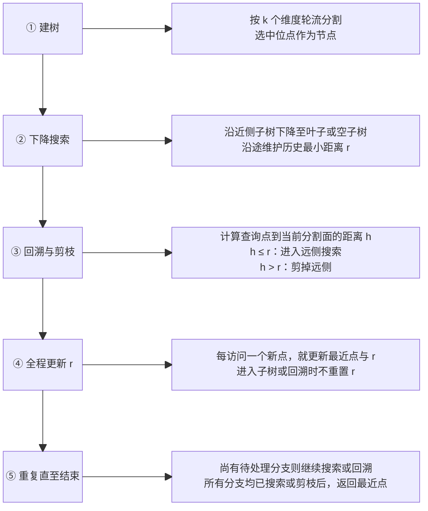
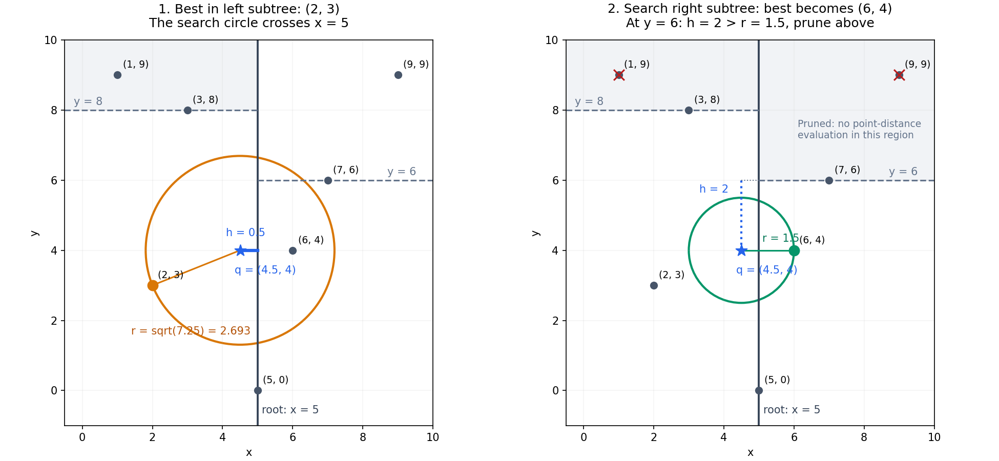

# F01-01：二维 KDTree 精确最近邻搜索

优先级：P0（对应仓库 F01：点集两两距离、KNN／Ball Query）。

状态：提供参考实现和验证脚本；是否能独立复写，由练习者自行记录。

本例只实现二维欧氏距离的 1-NN，重点是回溯与剪枝。三维版留作练习。

## 1. 题目定义

- 输入：N 个二维有限坐标以及一个二维查询点，坐标系、各轴单位一致。
- 输出：最近点、它在原始输入中的索引、欧氏距离，以及实际访问节点数。
- 空树返回 `None`。等距时选择原始索引最小者；重复点可以保留。
- 核心实现只使用 Python 3.10+ 标准库，不调用 SciPy 的 KDTree。
- 查询不会修改树；建树不会修改调用者传入的列表。

```powershell
cd 'F:\github\手撕\kdtree'
python -X utf8 demo.py
python -X utf8 check_kdtree.py
```

## 2. 理论与推导

KDTree 将点集按坐标轴递归划分。这里交替使用 x/y 轴，每次排序取中位点。
每个节点既保存一个数据点，也规定一条分割线；左子树当前轴坐标不大于中位点，右子树不小于中位点。
如果出现相同坐标，点可以分布在两侧，剪枝仍然成立。

### 建树：只需要记住分割约束

示例点集为 `(5,0), (3,8), (2,3), (1,9), (7,6), (6,4), (9,9)`。

```text
                       (5,0) [x=5]
                      /             \
             (3,8) [y=8]          (7,6) [y=6]
              /       \            /       \
          (2,3)      (1,9)       (6,4)      (9,9)
```

根节点沿 x=5 划分整个平面；左子树的 y=8 分割只作用于 x<=5 的区域，右子树的 y=6 分割只作用于 x>=5 的区域。
每个节点区域同时受到祖先分割条件的限制，不是每条分割线都无限地作用于整个平面。

### 搜索：维护当前最佳点，先搜近侧，再决定是否搜远侧

设查询点为 q，当前已找到的最近点距离为 r。访问节点 p、分割轴为 a 时：

1. 计算 q 到 p 的完整二维距离，必要时更新当前最佳点和 r。
2. 比较 q[a] 与 p[a]，先递归搜索 q 所在半空间的子树。
3. 近侧搜索结束后回到本节点，用**更新后的 r** 判断远侧能否剪枝。

设 q 到本节点分割线的距离为 `h = abs(q[a] - p[a])`。
远侧任意点 z 必须跨过这条分割线，因此：

```text
||q - z||² = (q[a] - z[a])² + 其他维度差的平方和
           >= (q[a] - z[a])²
           >= h²
```

所以：

- **h > r：** 远侧所有点都比当前最佳点更远，整棵远侧子树可以剪掉。
- **h <= r：** 仅凭这条分割线无法排除远侧，需要继续检查。

几何上，可以画以 q 为圆心、r 为半径的搜索圆。圆不触及分割线，就不可能包含另一侧的点。
圆触及分割线只说明不能用这个下界排除远侧，并不保证远侧真的存在更近的点。

代码全程比较距离平方，避免反复开平方；仅在返回最终距离时开平方。
本例保留等号以满足“等距时选最小原始索引”；若只需任意一个最近点，可采用不同的等距处理。

## 3. 算法流程图



第④步贯穿第②、③步：每访问一个点就立即更新 r。近侧、远侧由查询点位置决定，不固定为左、右子树。

## 4. 完整示例：q=(4.5,4)

| 步骤 | 操作 | 距离或下界 | 结论 |
|---|---|---|---|
| 1 | 访问根 (5,0) | 距离²=16.25 | 暂定最佳；q 在 x=5 左侧 |
| 2 | 访问 (3,8) | 距离²=18.25 | 不更新；q 在 y=8 下侧 |
| 3 | 访问叶子 (2,3) | 距离²=7.25 | 更新最佳，r≈2.693 |
| 4 | 回到 (3,8)，检查 y=8 上侧 | h²=16 > r²=7.25 | 跳过包含 (1,9) 的子树 |
| 5 | 回到根，检查 x=5 右侧 | h²=0.25 <= r²=7.25 | 必须继续搜索右侧 |
| 6 | 访问 (7,6) | 距离²=10.25 | 不更新；先搜索 y=6 下侧 |
| 7 | 访问 (6,4) | 距离²=2.25 | 更新最佳，r=1.5 |
| 8 | 回到 (7,6)，检查 y=6 上侧 | h²=4 > r²=2.25 | 跳过包含 (9,9) 的子树 |

最终最近邻是 `(6,4)`，距离 `1.5`，原始索引 `5`，访问 `5/7` 个节点。
若走到第一个叶子就停止，会错误地返回 `(2,3)`。



图中只画出理解这次查询所需的前三条分割线。橙色圆对应左子树搜索后的候选，绿色圆对应最终候选。
右图蓝色 h 量到 y=6 分割直线的延长线上，仍是远侧点距离的有效下界。

## 5. 最小手撕实现

- [kdtree_2d.py](kdtree_2d.py)：先看 `_build()`，重点看 `nearest()` 中的 `search()`。
- [demo.py](demo.py)：与上面完全一致的点集和查询，打印每次访问、更新和剪枝。
- [plot_search.py](plot_search.py)：可选的配图生成脚本，运行时额外需要 Matplotlib。

不要只搜索叶子：本例的内部节点也存放数据点，根节点可能就是真正最近邻。
递归函数返回上层就是“回溯”，不需要另外把查询点移动回某个空间位置。

## 6. 验证

[check_kdtree.py](check_kdtree.py) 使用独立的 `math.dist` 暴力枚举作为参考：

- 必须跨根分割线才能找到正确答案的样例。
- 空树、单点、重复点、共线点、等距点、分割线上的查询和范围外查询。
- 固定随机种子的整数、半整数和普通浮点点集。
- 原始索引保留、不修改输入，以及错误维数、NaN/Inf 拒绝行为。

暴力枚举虽然慢，却非常适合检验剪枝有没有漏掉更好的候选。不要只与另一个同样的递归实现比较。

## 7. 追问与三维练习

1. 三维点如何表示？分割轴怎样在 x/y/z 之间轮换？
2. 分割线变为分割平面后，`abs(q[a] - p[a])` 为什么仍然是距离下界？
3. 二维圆变为三维球后，回溯逻辑是否需要改变？
4. 用独立的三维暴力枚举验证空集、重复点、共面点、等距点与跨平面回溯。
5. **半径查询：** 维护固定半径 R，收集所有距离不大于 R 的点；剪枝比较 h 与 R。
6. **k-NN：** 维护最好的 k 个候选；候选满 k 个后，最差候选距离才形成有效剪枝半径。

二维参考代码没有提前实现三维版或半径查询，供你自行完成。

### 时间复杂度和工程区别

- 本例建树每层对子集排序，时间为 O(n log² n)，树本身空间为 O(n)。更高效的建树实现可避免这种重复排序开销。
- 平衡只保证树深约 O(log n)，不保证一次查询只访问一条根到叶路径。
- 低维且数据分布适合剪枝时，查询通常比全量扫描少访问很多点；最坏仍会访问全部 n 个点。
- 维度升高后，更多区域难以剪枝；SciPy 文档特别提醒，约 20 维时就不应指望必然明显快于暴力搜索。
- 工程实现可能使用子树包围盒距离提供更紧的下界、不同分割规则，以及叶节点小批量暴力搜索。本例只使用分割线下界。

### 与已有项目的关系

切帧项目 `D:/12345/seres_project/prelabel_model/post_process/core/static_mapping/static_mapping.py` 使用 `query_ball_point`：
先用二维圆筛选候选框中心，再做精确 ROI 判断；又用三维外接球查询候选点，再统计精确 OBB 内点数。
KDTree 负责加速候选空间搜索，最后是否保留目标由框内点数等业务条件决定。

MASt3R 的三维 pointmap 匹配使用另一种查询：先找最近邻，再结合反向搜索确定互为最近邻。
互惠检查不属于 KDTree 本身；树只负责提供单次 NN 查询结果。

## 资料与复盘

- [SciPy KDTree：索引、叶节点与高维限制](https://docs.scipy.org/doc/scipy/reference/generated/scipy.spatial.KDTree.html)
- [SciPy query：最近邻与精确／近似查询参数](https://docs.scipy.org/doc/scipy/reference/generated/scipy.spatial.KDTree.query.html)
- [SciPy query_ball_point：半径内点查询](https://docs.scipy.org/doc/scipy/reference/generated/scipy.spatial.KDTree.query_ball_point.html)

自己的三维实现：待完成。复盘时记录“哪里误剪了分支、是否漏查内部节点、是否使用了最新的最佳距离”。
